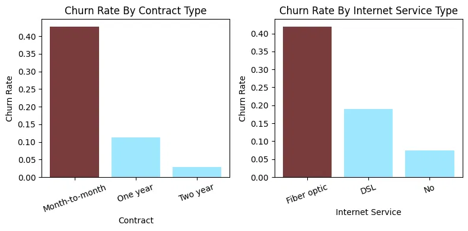
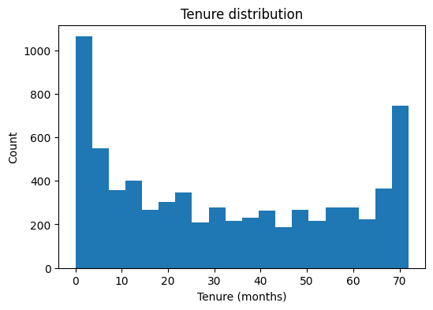

# Telecom Customer Churn Prediction

An end-to-end data science project predicting customer churn for a telecom company — from raw data exploration to machine learning predictions on 24,000+ unseen records.

---

## Project Overview

Customer churn is one of the most critical business problems in the telecom industry. Acquiring a new customer costs significantly more than retaining an existing one. This project builds a complete churn prediction pipeline — from data cleaning and feature engineering to model training, evaluation, and deployment on a new dataset.

**Business Question:** Which customers are likely to leave, and what are the key drivers of churn?

---

## Project Structure

```
├── data/
│   ├── churn.csv                    # IBM Telco Customer Churn dataset (input for Part A)
│   └── churn-Part-A.csv             # Encoded training data (output of Part A, input for Part B)
├── BigDataProject-Part-A.ipynb      # EDA, feature engineering, model training
├── BigDataProject-Part-B.ipynb      # MongoDB pipeline + churn prediction
├── Presentation-BigData.ppsx        # Project presentation with business insights
├── churn_by_contract_internet.png
├── tenure_distribution.png
├── requirements.txt
└── README.md
```

## How to Run

```bash
pip install -r requirements.txt
jupyter notebook
```

1. Run `BigDataProject-Part-A.ipynb` — reads `data/churn.csv` and writes `data/churn-Part-A.csv`
2. Part B requires a local MongoDB (`mongodb://localhost:27017/`) with the `Tech.Customers` collection 
   (the 25,000-document collection is not included in this repo)

---

## Part A — EDA, Feature Engineering & Model Training

**Dataset:** 7,043 telecom customers with 19 features (plus customer ID and the churn label) covering demographics, services, contract details, and billing information. After encoding, the model uses 26 numeric features.

### Key Steps

**Data Cleaning**
- Identified and resolved `total_charges` misclassification (string → numeric)
- Imputed missing values based on business logic: new customers (`tenure = 0`) received `total_charges = 0`
- Unified inconsistent categorical values (`No internet service` / `No phone service` → `No`)

**Feature Engineering**
- Created `tenure_segment` groups (0–12, 13–24, 25–36, 37–48, 49–60, 61–72 months)
- Applied three encoding strategies:
  - One-Hot Encoding: gender, internet service, payment method
  - Ordinal Encoding: tenure segment, contract type
  - Label Encoding: all binary yes/no features

**Models Trained & Compared**

| Model | Test Accuracy | Recall (churners) |
|---|---|---|
| Benchmark (majority class) | ~74% | 0% |
| Decision Tree | ~78% | — |
| Random Forest | ~79% | ~48% |
| KNN | ~77% | — |
| Random Forest, `class_weight='balanced'` | ~74% | **~76%** |

**Winner on accuracy:** Random Forest (`n_estimators=9`, `max_depth=7`) — best test accuracy (79.3%) with a small train–test gap (2.6 pp).

**Beyond accuracy:** with only ~26% churners, accuracy is misleading — the accuracy-optimized model catches less than half of the customers who actually leave. A balanced Random Forest raises recall to ~76% (5-fold CV recall: 79%) at the cost of more false alarms, which is usually the better trade-off for a retention campaign.

---

## Part B — MongoDB Pipeline & Prediction on Unseen Data

**Dataset:** 24,218 customer records stored in a MongoDB collection with nested `Services` documents.

### Key Steps

- Connected to MongoDB and queried all valid documents using MQL
- Flattened nested `Services` subdocuments into separate feature columns
- Applied identical preprocessing pipeline as Part A
- Applied trained Random Forest model to predict churn on unseen data
- *Requires a local MongoDB — the collection is not included in this repo; prediction results below are from the original local run*
- Exported results to CSV for business use

### Prediction Results

| Outcome | Count | Percentage |
|---|---|---|
| Predicted to Stay | 18,288 | ~75.5% |
| Predicted to Churn | 5,930 | ~24.5% |

---

## Visualizations

### Churn Rate by Contract and Internet Service
Month-to-month and fiber optic customers show the highest churn rates (above 40%).



### Tenure Distribution
A large share of customers are in their first months, the segment with the highest churn risk.



---

## Key Business Insights

**1. Contract type is the strongest churn predictor**
Customers on month-to-month contracts churn significantly more than those on one- or two-year contracts.
→ Offer incentives to migrate short-term customers to longer contracts.

**2. Fiber optic users show the highest churn rate**
Despite being a premium service, fiber optic customers are more likely to leave than DSL users.
→ Investigate service quality and pricing satisfaction among fiber optic users.

**3. New customers are the highest-risk segment**
Customers with tenure under 12 months represent the most vulnerable group.
→ Invest in onboarding experience and early retention programs.

---

## Tech Stack

| Tool | Usage |
|---|---|
| Python | Core language |
| pandas | Data manipulation and cleaning |
| scikit-learn | Machine learning models |
| matplotlib / seaborn | Data visualization |
| MongoDB / pymongo | NoSQL database and querying |
| Jupyter Notebook | Development environment |

---

## Dataset

Based on the [IBM Telco Customer Churn dataset](https://www.kaggle.com/datasets/blastchar/telco-customer-churn) — a widely used benchmark for churn prediction tasks.

---

## Author

**Valeria Barabanova**
Junior Data Analyst | Tel Aviv, Israel
[LinkedIn](https://linkedin.com/in/valeriabarabanova) · [GitHub](https://github.com/barabanovalera1-ui)
